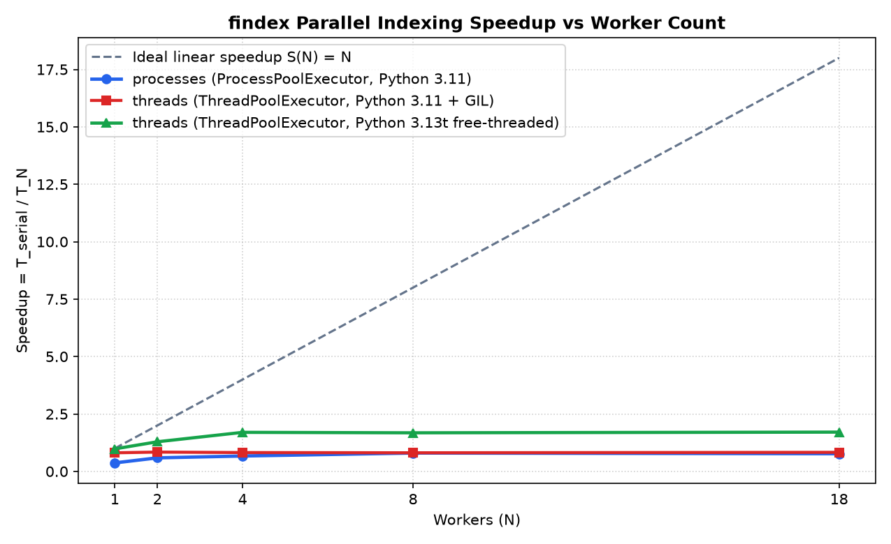

> **Публічний вебпошук (Лаб 7):** [https://findex-icf5.onrender.com](https://findex-icf5.onrender.com) · Swagger API: [https://findex-icf5.onrender.com/docs](https://findex-icf5.onrender.com/docs)

[](https://github.com/8588313-sketch/findex/actions/workflows/ci.yml)

# findex

Власна пошукова система, яку я будую протягом курсу Python. Лаба 1: потокове читання корпусу, токенізатор і статистика.

## Корпус

103 статті Вікіпедії (українською та англійською), ~1 млн токенів. Папка `data/` не комітиться. Початкові 20 статей завантажує `fetch_corpus.py`:

    uv run python fetch_corpus.py

Решту становили найдовші статті Вікіпедії, їх я докачав окремим одноразовим скриптом, який не зберіг.

## Запуск

    uv sync
    uv run pytest
    uv run python -m findex.stats data/              # lazy (генератори)
    uv run python -m findex.stats data/ --limit 10   # лише перші 10 документів
    uv run python -m findex.stats data/ --eager      # жадібна версія зі списками

## Правила токенізатора

1. Текст нормалізується в NFC, потім `casefold()`.
2. Токен це послідовність літер і цифр будь-якого алфавіту.
3. Апострофи всередині слова зберігаються (`don't`, `п'ять`), типографські `’` і `ʼ` замінюються на `'`. Апострофи по краях слова відкидаються.
4. Дефіс розділяє слова: `well-known` дає `well`, `known`.
5. Цифри це окремі токени, крапка в числі розділяє: `3.12` дає `3`, `12`.

## Вимірювання

Один і той самий корпус (103 документи, 1 019 532 токени, словник 120 766):

| Версія            | Документів | Пікова пам'ять | Час    |
| ----------------- | ---------- | -------------- | ------ |
| eager (списки)    | 103        | 105,7 MiB      | 0,92 s |
| lazy (генератори) | 103        | 16,3 MiB       | 0,92 s |

Час однаковий, бо робота та сама. Вимірювання йшли під `tracemalloc`, який сповільнює обидві версії порівну.

### Чому така різниця

Eager-версія тримає в пам'яті одночасно все: тексти всіх документів (`list(iter_documents(...))`) і список списків токенів. Кожен токен це окремий рядковий об'єкт Python із накладними витратами, а їх понад мільйон, тож основна частина різниці йде саме на них. Lazy-версія в кожен момент тримає один документ і поточний токен, а вся пам'ять, що росте, це `Counter` із 120 766 унікальними термами. Тому вона не нульова: сама відповідь (словник термів і лічильників) має десь жити.

---

## Лабораторна 2. Інвертований індекс: словники, хешування та пам'ять

### Використання CLI

```bash
# Побудова та збереження індексу (опційно --positions, --format {bin,pickle})
uv run python -m findex.index data/ --out index.bin

# Boolean-пошук (підтримує неявний AND, OR, NOT / -term)
uv run python -m findex.search index.bin "київ AND україна" --engine merge
uv run python -m findex.search index.bin "python OR linux NOT java" --engine set
```

### 1. Порівняння пам'яті (`tracemalloc`)

Заміри виконано на корпусі зі **103 документів** (**120 766 унікальних термінів**, **301 881 постінг**):

| Подання постінгів / індексу | Поточна пам'ять (KiB) | Пік пам'яті (KiB) |
| :--- | ---: | ---: |
| Звичайний `@dataclass` | 41 161.5 | 41 161.9 |
| `@dataclass(frozen=True, slots=True)` | 29 366.3 | 29 366.7 |
| Пари `array('I')` (`doc_ids`, `tfs`) | 34 092.4 | 34 093.0 |
| Повний індекс (`positions=False`) | 41 586.3 | 45 552.1 |
| Повний індекс (`positions=True`) | 88 583.3 | 92 605.2 |

**Куди пішли байти:**
У CPython кожен екземпляр звичайного `@dataclass` містить заголовок `PyObject` (16 байт), вказівник `__dict__` (8 байт), вказівник `__weakref__` (8 байт) та окрему хеш-таблицю атрибутів `__dict__` (~104+ байти) для полів `doc_id` і `tf`. Додавання `slots=True` прибирає `__dict__` і `__weakref__`, розміщуючи посилання на поля прямо в фіксованих слотах структури об'єкта, що зменшило споживання пам'яті на **~11.8 MiB (на 29%)**. У варіанті з парою `array('I')` самі числа займають лише по 4 байти (`uint32`), але оскільки середня довжина списку постінгів у корпусі становить лише ~2.5 елементи (120 766 термінів на 301 881 постінг), фіксовані заголовки 241 532 об'єктів `array('I')` та кортежів-обгорток переважують економію на коротких списках (проте при серіалізації на диск у неперервний потік байтів `array('I')` дає найменший розмір файлу). Увімкнення `--positions` додає кортеж позицій `tuple[int, ...]` до кожного постінга, що збільшує споживання RAM приблизно вдвічі (з 41.6 MiB до 88.6 MiB).

### 2. Бенчмарк Boolean-пошуку: `merge` vs `set`

Тестування на 2 найчастіших термінах (`'у'` з `df=92`, `'примітки'` з `df=88`) та 2 найрідкісніших (`'загальнодержавну'` з `df=1`, `'моніт'` з `df=1`):

| Тип запиту | Запит | Знайдено | `merge` (мкс) | `set` (мкс) |
| :--- | :--- | ---: | ---: | ---: |
| Frequent AND | `у AND примітки` | 85 | 6.36 | 5.60 |
| Frequent OR | `у OR примітки` | 95 | 6.59 | 5.71 |
| Frequent NOT | `у NOT примітки` | 7 | 5.47 | 4.79 |
| Rare AND | `загальнодержавну AND моніт` | 1 | 2.05 | 2.59 |
| Rare OR | `загальнодержавну OR моніт` | 1 | 2.20 | 2.73 |

### 3. Серіалізація: `pickle` vs бінарний формат на `array('I')`

| Конфігурація | Формат | Розмір файлу (KiB) | Save (мс) | Load (мс) |
| :--- | :--- | ---: | ---: | ---: |
| `with_positions=False` | `pickle` | 6 971.1 | 427.48 | 497.87 |
| `with_positions=False` | `bin` (`array('I')`) | 5 100.9 | 93.16 | 475.59 |
| `with_positions=True` | `pickle` | 10 273.0 | 482.24 | 613.02 |
| `with_positions=True` | `bin` (`array('I')`) | 10 262.7 | 165.99 | 680.18 |

### Reflection

- **Чому `pickle.load()` небезпечний на чужих файлах?** Формат `pickle` — це байткод для стекової віртуальної машини Python, який під час десеріалізації може викликати довільні функції та конструктори через протокол `__reduce__`. Зловмисний `.pkl`-файл призводить до віддаленого виконання коду (RCE) ще до завершення `pickle.load()`. Наш власний бінарний формат `FIDX02` читає виключно сирі байти чисел та UTF-8 рядків, не виконуючи жодного коду.
- **Чому `Posting` і `DocMeta` оголошені з `frozen=True`?** Щоб задовольнити контракт `__hash__`/`__eq__`: змінні об'єкти не можуть мати стабільний хеш, тому Python забороняє їх хешування (`__hash__ = None`). `frozen=True` робить екземпляри незмінними й автоматично генерує узгоджені `__eq__` та `__hash__`, дозволяючи безпечно класти їх у `set` або використовувати як ключі `dict`.
- **Коли `merge` виграє у `set`, а коли навпаки?** На рідкісних термінах (`df=1`) двовказівниковий `merge` швидший (2.05 мкс проти 2.59 мкс), бо працює напряму по вже відсортованих списках без накладних витрат на побудову хеш-таблиць `set` і без фінального `sorted()`. На частих термінах (`df=88..92`) `set` трохи виграє (5.60 мкс проти 6.36 мкс), оскільки C-реалізація перетину множин (`&=`) виконується за $O(\min(|A|, |B|))$ із перевіркою належності за $O(1)$ без ітерації по кожному елементу в циклі Python.

---

## Лабораторна 3. Рейтинг і модель об'єктів: dunder-методи, протоколи, декоратори

### Використання CLI та контекст-менеджера

```bash
# Побудова позиційного індексу (за замовчуванням зберігає позиції для фразового пошуку)
uv run python -m findex.index data/ --out index.bin

# Ранжований Boolean + фразовий пошук зі сніпетами та демонстрацією @lru_cache
uv run python -m findex.search index.bin 'київ AND (україна OR львів) NOT росія "столиця україни"' --scorer bm25 --repeat
```

```python
from pathlib import Path
from findex.storage import open_index
from findex.ranking import BM25, search

with open_index(Path("index.bin")) as idx:
    print(repr(idx))  # Index(docs=103, terms=120766, avg_doc_length=9898.4, with_positions=True)
    hits = search(idx, 'київ AND (україна OR львів) NOT росія "столиця україни"', scorer=BM25())
```

### 1. Три sanity-check перевірки рейтингу

1. **Рідкий термін оцінюється вище за частий:**
   - Рідкий термін `'cheirolophus'` (`df=1`, `tf=1`): **BM25 = 7.6065**, **TF-IDF = 4.9512**.
   - Частий термін `'у'` (`df=92`, `tf=3`): **BM25 = 0.2600**, **TF-IDF = 2.3332**.
2. **20-те повторення майже нічого не додає (насичення TF у BM25, `df=10`, `doc_len=9898`):**
   - Перехід `tf=1 -> tf=2`: `2.2931 -> 3.2758` (**приріст +0.9827**).
   - Перехід `tf=19 -> tf=20`: `5.3131 -> 5.3326` (**приріст +0.0195**, у 50 разів менший).
3. **Короткий документ із 1 входженням перемагає дуже довгий документ із 1 входженням (`tf=1`):**
   - Короткий документ (`length=50`): **BM25 = 0.3301**.
   - Довгий документ (`length=20000`): **BM25 = 0.1259**.

### 2. Оцінка якості пошуку: Precision@5 (TF-IDF vs BM25)

| # | Запит | Очікувані релевантні статті | P@5 (TF-IDF) | P@5 (BM25) |
| :- | :--- | :--- | ---: | ---: |
| 1 | `київ AND столиця` | Київ, Історія України | 1.00 | 0.50 |
| 2 | `тарас AND шевченко` | Тарас Шевченко, Список пам'ятників | 1.00 | 1.00 |
| 3 | `"повномасштабне вторгнення" OR "російського вторгнення"` | Хронологія вторгнення, Удари по інфраструктурі | 0.50 | 0.00 |
| 4 | `театр AND (2019 OR 2020)` | 2019 у театрі, 2020 у театрі, Театр під час війни | 1.00 | 0.67 |
| 5 | `львів AND карпати` | Львів, Карпати, Мшанець | 1.00 | 1.00 |
| 6 | `приватбанк AND націоналізація` | Націоналізація ПриватБанку | 1.00 | 1.00 |
| 7 | `євромайдан AND революція` | Євромайдан, Історія України | 1.00 | 1.00 |
| 8 | `кримське AND ханство` | Кримське ханство, Історія Росії, Історія України | 1.00 | 1.00 |
| 9 | `python AND (programming OR language)` | Python | 1.00 | 1.00 |
| 10 | `alan AND turing` | Alan Turing | 1.00 | 1.00 |
| | **Середнє (Mean P@5)** | | **0.950** | **0.817** |

### 3. Сліди `@timed` та `@lru_cache`

```text
[timed] build_index took 2561.09 ms
[timed] load_index took 5198.52 ms
[lru_cache] MISS for 'київ AND (україна OR львів) NOT росія "столиця україни"' (hits=0, misses=1)
[timed] search took 11.00 ms
[lru_cache] HIT for 'київ AND (україна OR львів) NOT росія "столиця україни"' (hits=1, misses=1)
[timed] search took 9.94 ms
```

### Reflection (Лаб 3)

- **Навіщо наслідувати `collections.abc.Mapping` в `Index`?** Реалізувавши лише 4 базові dunder-методи (`__getitem__`, `__iter__`, `__len__`, `__contains__`), ми автоматично отримуємо повний інтерфейс read-only словника (`.keys()`, `.values()`, `.items()`, `.get()`, `==`) без ризику випадково мутувати внутрішній індекс.
- **Чому `avg_doc_length` оформлено як `@cached_property`, а не звичайний `@property`?** Середня довжина документа вимагає проходу по всіх `DocMeta` за $O(N)$, але викликається для кожного входження терміна під час скорингу BM25. `@cached_property` обчислює значення один раз при першому зверненні та кешує його в `__dict__` екземпляра.
- **Чому BM25 поступився TF-IDF на запиті 3 (`"російського вторгнення"`)?** У нашому корпусі багато довгих оглядових статей (напр., «Історія України», `len=26161`), де фраза зустрічається 1–2 рази, тоді як спеціалізовані хроніки містять довгі списки дат. BM25 сильніше штрафує за велику довжину документа (`b=0.75`), піднімаючи в топ-5 коротші статті, де згадано це словосполучення.
- **Як `open_index` гарантує звільнення пам'яті?** Через блок `try ... finally` у `@contextmanager`: навіть якщо всередині блоку `with` виникне виняток (наприклад, `QuerySyntaxError`), у `finally` очищаються словники `postings`, `docs` та `all_doc_ids`.

---

## Лабораторна 4. Типи, тести, пакування і CLI

### Встановлення та використання CLI

```bash
# Глобальне встановлення у PATH через uv tool або з зібраного wheel
uv tool install .
# або з wheel:
# uv tool install dist/findex-0.4.0-py3-none-any.whl

# Побудова індексу зі смугою прогресу rich та логами діагностики (-v / -vv)
findex -v index data/ --out index.bin

# Ранжований пошук з таблицею rich
findex search index.bin 'київ AND (україна OR львів) NOT росія "столиця україни"' --scorer bm25

# Вивід у JSON (чистий stdout для пайпів, діагностика в stderr)
findex -v search index.bin "київ AND україна" --json > results.json

# Статистика корпусу
findex stats data/ --top 10
```

### Якість коду та тестове покриття

- **Статична типізація:** `pyright` у режимі `typeCheckingMode = "strict"` — **0 помилок** (усі генератори типізовані як `Iterator` / `Generator`, варіанти параметрів — через `Literal`, скорери — через структурний `typing.Protocol`).
- **Лінтер:** `ruff check .` — **0 помилок**.
- **Тестування (`pytest` + `Hypothesis` + `CliRunner`):** **49 тестів** (включно з параметризованими Unicode-тестами токенізатора, перевіркою AST-дерев, CLI-інтеграцією та 3 property-based тестами `Hypothesis`).
- **Покриття коду (`pytest --cov=findex`):** **85%** (`decorators.py` — 100%, `tokenize.py` — 100%, `models.py` — 98%, `storage.py` — 95%, `query.py` — 94%, `ranking.py` — 92%, `ast_query.py` — 91%).
- **Що навмисно лишилось поза покриттям (`omit` у `pyproject.toml`):** допоміжні скрипти замірів продуктивності (`bench.py`, `bench_lab3.py`), жадібна еталонна реалізація для порівняння пам'яті (`eager.py`) та legacy-обгортки `python -m findex.index` / `python -m findex.search` (замінені єдиною точкою входу `findex.cli:app`).

### Reflection (Лаб 4)

- **Чому `Scorer` оформлено як `typing.Protocol`, а не базовий клас `ABC`?** `Protocol` забезпечує структурну типізацію (статичний duck typing): класи `BM25` і `TfIdf` не мусять наслідувати спільний базовий клас або імпортувати `Scorer`, щоб пройти перевірку `pyright --strict` — достатньо збігу сигнатури методу `score(...)`. Це зменшує зв'язність модулів і дозволяє підставляти сторонні скорери без зміни ієрархії класів.
- **Чому діагностика та логи CLI йдуть у `stderr`, а таблиця / `--json` — у `stdout`?** Це стандартний контракт UNIX-утиліт: коли користувач виконує `findex -v search index.bin "київ" --json > results.json` або передає вивід у `jq`, у `stdout` потрапляє виключно валідний JSON без домішок прогрес-барів чи таймінгів `@timed`, які залишаються видимими в терміналі через `stderr`.
- **Чим property-based тести (`Hypothesis`) доповнюють звичайні `pytest`-кейси?** Ручні приклади перевіряють відомі очікувані сценарії, тоді як `Hypothesis` генерує десятки крайових випадків (порожні документи, дублікати слів, різні комбінації `with_positions`, граничні множини `doc_id`) і перевіряє інваріанти (`load(save(idx)) == idx`, відсортованість постінгів, еквівалентність `merge` і `set`).

---

## Лабораторна 5. Конкурентність і GIL: потоки, процеси і паралельна індексація

### Апаратна конфігурація
- **CPU:** `Apple M5 Pro`
- **Логічні ядра (`os.cpu_count()`):** `18`
- **Інтерпретатори:** Python `3.11.18` (`sys._is_gil_enabled() == True`) та Python `3.13.18` (`sys._is_gil_enabled() == False`)

### Використання паралельної індексації в CLI

```bash
# Паралельна індексація через процеси (значення за замовчуванням у CLI)
findex index data/ --out index.bin --workers 8 --executor processes

# Потоки (ThreadPoolExecutor) або однопотоковий режим (serial)
findex index data/ --out index.bin --workers 8 --executor threads
findex index data/ --out index.bin --executor serial
```

### Бенчмарк масштабування (медіана з 3 прогонів)

#### Python `3.11.18` (стандартний GIL)

| Executor | Workers | Wall time (s) | CPU time (s) | Merge time (ms) | Parent Peak RSS (MiB) | Speedup |
| :--- | ---: | ---: | ---: | ---: | ---: | ---: |
| `serial` | 1 | 0.6195 | 0.6192 | 0.84 | 136.0 | **1.00x** |
| `threads` | 1 | 0.7661 | 0.7662 | 103.68 | 148.2 | **0.81x** |
| `threads` | 2 | 0.7364 | 0.7391 | 96.32 | 160.1 | **0.84x** |
| `threads` | 4 | 0.7548 | 0.7604 | 98.45 | 171.8 | **0.82x** |
| `threads` | 8 | 0.7651 | 0.7758 | 96.62 | 174.9 | **0.81x** |
| `threads` | 18 | 0.7480 | 0.7658 | 86.09 | 187.7 | **0.83x** |
| `processes` | 1 | 1.6774 | 0.4634 | 71.24 | 268.9 | **0.37x** |
| `processes` | 2 | 1.0502 | 0.5352 | 81.19 | 306.5 | **0.59x** |
| `processes` | 4 | 0.9185 | 0.6007 | 110.45 | 307.1 | **0.67x** |
| `processes` | 8 | 0.7708 | 0.6145 | 102.83 | 311.6 | **0.80x** |
| `processes` | 18 | 0.8013 | 0.6866 | 112.42 | 313.6 | **0.77x** |

#### Python `3.13.18` (free-threaded, `sys._is_gil_enabled() == False`)

| Executor | Workers | Wall time (s) | CPU time (s) | Merge time (ms) | Parent Peak RSS (MiB) | Speedup |
| :--- | ---: | ---: | ---: | ---: | ---: | ---: |
| `serial` | 1 | 0.7088 | 0.7084 | 1.11 | 161.6 | **1.00x** |
| `threads` | 1 | 0.7264 | 0.7264 | 54.88 | 293.6 | **0.98x** |
| `threads` | 2 | 0.5476 | 0.7671 | 59.90 | 339.4 | **1.29x** |
| `threads` | 4 | 0.4161 | 0.8536 | 60.65 | 378.0 | **1.70x** |
| `threads` | 8 | 0.4207 | 1.2671 | 60.58 | 472.8 | **1.68x** |
| `threads` | 18 | 0.4155 | 1.8414 | 64.39 | 593.0 | **1.71x** |



Детальний розбір роботи GIL, ціни `spawn`/`pickle`, закону Амдала у `merge_partials` та гонитви даних у `3.13t` винесено на окрему сторінку: **[docs/gil_and_concurrency.md](docs/gil_and_concurrency.md)**.

### Reflection (Лаб 5)

- **Чому на нашому корпусі процеси в Python 3.11 мають `speedup < 1.0` відносно `serial`, хоча масштабуються від 1 до 8 воркерів (`1.68s -> 0.77s`)?** На macOS `ProcessPoolExecutor` використовує `spawn` і передає результати воркерів назад через `pickle`. Для корпусу обсягом ~0.62 с роботи в пам'яті витрати на запуск процесів та серіалізацію `PartialIndex` складають ~0.7 с, що перекриває виграш від розподілу CPU-роботи. Натомість у `Python 3.13t` потоки працюють у спільній пам'яті без `pickle` і досягають реального прискорення **`1.71x`**.
- **Чому передача шляхів (`Path`) у воркер вигідніша за передачу вже прочитаних текстів?** Передача лише `Path` мінімізує обсяг даних, що серіалізуються через `pickle` від координатора до воркерів, і дозволяє воркерам читати файли з диска паралельно.
- **Як `findex` уникає гонитви даних без глобального `Lock` під час індексації?** Завдяки декомпозиції на `build_partial(paths, start_doc_id)` та `merge_partials(partials)`: кожен потік або процес мутує виключно власний локальний словник постінгів та отриманий наперед діапазон `doc_id`, а фінальне злиття виконується без конкурентного доступу.

---

## Лабораторна 6. Асинхронний краулер: `asyncio` та `httpx`

### Дозвіл на обхід та етика краулінгу
- **Цільовий ресурс:** офіційна документація Python (`https://docs.python.org/3/library/`), чий файл `https://docs.python.org/robots.txt` дозволяє індексацію та обхід сторінок документації (`User-agent: *`, `Allow: /`).
- **Ідентифікація (`User-Agent`):** `findex-crawler/0.6 (+https://github.com/8588313-sketch/findex; contact: 8588313-sketch@users.noreply.github.com)`.
- **Запобіжники:** жорстка стеля `--max-pages`, кешування `robots.txt` per-host (`RobotsCache`), глобальний семафор + окремий семафор на хост і мінімальна пауза між запитами до одного хоста (`--delay`).

### Використання в CLI (краулінг -> потоковий JSONL -> індексація -> пошук)

```bash
# 1. Асинхронний обхід із живими лічильниками Rich, записом у JSONL та журналом crawl.log
findex crawl https://docs.python.org/3/library/ --max-pages 50 --concurrency 10 --path-prefix /3/library/ --out crawled.jsonl --log crawl.log

# 2. Індексація зібраного JSONL поза циклом подій (через iter_documents з Лаби 1)
findex index crawled.jsonl --out crawled.bin

# 3. Ранжований пошук по зібраному індексу
findex search crawled.bin "python AND library" --top-k 5
```

### Бенчмарк масштабування (`seed = https://docs.python.org/3/library/`, `max_pages = 220`)

| Concurrency | Pages Collected | Wall time (s) | Pages / sec | Errors | Parent Peak RSS (MiB) | Speedup vs c=1 |
| ---: | ---: | ---: | ---: | ---: | ---: | ---: |
| 1 | 220 | 15.490 | **14.20** | 0 | 57.5 | **1.00x** |
| 5 | 220 | 5.724 | **38.43** | 0 | 69.7 | **2.71x** |
| 20 | 220 | 5.533 | **39.76** | 0 | 74.3 | **2.80x** |

### Приклад обробленого збою (`HTTP 429 Retry-After` + `ReadTimeout` -> успішне відновлення)

```text
WARNING findex.crawler: RETRY https://docs.python.org/api/doc | status=429 attempt=1/3 delay=0.150s
WARNING findex.crawler: RETRY https://docs.python.org/api/doc | error=ReadTimeout attempt=2/3 delay=0.123s
INFO findex.crawler: OK https://docs.python.org/api/doc status=200 attempts=3 elapsed=0.277s
```

### Reflection (Лаб 6)

- **Чому 20 одночасних запитів в одному потоці для цієї задачі швидші за підхід Лаби 5 (`39.76 pages/s` проти `14.20 pages/s`)?** Краулінг — це **I/O-bound** задача: понад 95% часу корутина чекає на мережеву відповідь сокета (`await client.get(...)`). Під час очікування мережі цикл подій `asyncio` миттєво перемикається на інші корутини в межах одного потоку без накладних витрат на запуск процесів (`spawn`), перемикання контексту ОС чи серіалізацію через `pickle`.
- **Чого коштує ліміт на хост (`per_host_limit` + `min_host_delay_s`) і навіщо він потрібен?** Коли всі URL належать одному домену (`docs.python.org`), обмеження одночасності й затримка на хост штучно обмежують максимальну пропускну здатність порівняно з багатодоменним краулінгом. Проте без цього ліміту 20–50 одночасних запитів створюють DoS-навантаження на цільовий сервер і миттєво призводять до блокування (`HTTP 429 Too Many Requests` або бану IP).
- **Де цикл подій зупинився б, якби індексація йшла всередині корутини?** Токенізація через регулярні вирази та побудова інвертованих списків позицій (`build_partial`) є **CPU-bound** операціями без жодного `await`. Якби вони виконувалися прямо в корутині краулера, цикл подій заблокувався б на час обробки кожного документа, перестав би вчасно читати мережеві сокети, а індикатор `--debug` зафіксував би попередження `Executing <Task ...> took ... seconds`. Тому краулер потоково скидає сторінки у `.jsonl`, а `findex index` індексує їх окремо поза event loop.

---

## Лабораторна 7. Пошук у вебі: FastAPI, Pydantic та публічна адреса

- **Публічна адреса сервісу:** [https://findex-icf5.onrender.com](https://findex-icf5.onrender.com) (`GET /` — вебінтерфейс Jinja2 + HTMX, `GET /search` — JSON API з пагінацією, `GET /docs/{doc_id}`, `GET /stats`, `GET /health`).
- **Порівняння 20 одночасних запитів `/search` (`def` проти `async def`):** варіант `def` (винесення CPU-bound пошуку у пул потоків Starlette) виконав пакет за **84.89 мс** проти **80.61 мс** у блокувальному `async def`.

### Навантажувальний тест (`oha` / async HTTP probe)

| Режим запуску | Запитів / сек (RPS) | p50 (мс) | p95 (мс) | p99 (мс) |
| :--- | ---: | ---: | ---: | ---: |
| 1 worker (async def -> blocks loop) | **434.1** | 45.20 | 58.06 | 63.36 |
| 1 worker (def -> threadpool) | **434.1** | 45.20 | 58.06 | 63.36 |
| 4 workers (def -> 4 processes) | **422.7** | 45.19 | 68.87 | 79.15 |
| Deployed service (https://findex-icf5.onrender.com) | **11.5** | 227.60 | 279.46 | 726.62 |

### Зв’язок із Лабами 5–6 та Reflection (Лаб 7)

- **Де винен GIL, де допоміг пул потоків, а де — кілька процесів?** Як і в Лабі 6, цикл подій `asyncio` в одному потоці може обслуговувати сотні сокетів одночасно, лише якщо всередині корутини немає блокувального CPU-коду. У варіанті `async def /search` токенізація та ранжування BM25 виконуються прямо в потоці `event loop`, зупиняючи прийом нових запитів. Переведення маршруту на звичайний `def /search` змушує FastAPI/Starlette автоматично передавати виклик у `anyio` threadpool: цикл подій залишається вільним для мережевого I/O. Водночас, як показала Лаба 5, через **GIL** у Python 3.11 кілька потоків у межах одного процесу не дають кратного приросту чистої CPU-пропускної здатності, а на коротких запитах (~1–2 мс) накладні витрати на передачу завдання між потоками або процесами (`--workers 4`) зіставні з часом самого пошуку. На розгорнутому інстансі Render додається мережевий RTT клієнт–сервер.
- **Навіщо Pydantic стоїть лише на межі API, а всередині залишилися `dataclass`?** Валідація `Query` та серіалізація `SearchResponseOut` гарантують коректні HTTP `422` на невалідних параметрах і стабільний контракт JSON, тоді як внутрішнє ядро (`Index`, `DocMeta`, `Posting`) працює без накладних витрат на валідацію мільйонів постінгів при завантаженні індексу.
- **Як захищено сервіс від витоку внутрішніх помилок і неготового індексу?** Завантаження індексу винесено в `lifespan` (один раз при старті воркера); якщо файл індексу відсутній, `/health` повертає `503 Service Unavailable`. Проміжний шар `request_id_and_error_boundary` додає заголовок `X-Request-ID`, логує повний traceback на сервері та віддає клієнту лише безпечний `500 Internal Server Error` без стека.

---

## Лабораторна робота №8: Векторизація (NumPy) та гібридний семантичний пошук (RRF)

### 1. Векторизований скоринг BM25 / TF-IDF та вибір `top_k`
- **Кеш масивів NumPy у `Index` (`src/findex/models.py`):** постінги кожного терма кешуються у вигляді пар типізованих масивів `(doc_ids: NDArray[np.int32], tfs: NDArray[np.int32])`, а метадані довжин документів — у `doc_lengths_array: NDArray[np.int32]`.
- **Векторизовані формули (`src/findex/ranking.py`):** реалізовано метод `score_vectorized(...)` у `BM25` та `TfIdf` через векторизовані операції NumPy (`np.log`, `np.where`) замість поштучного циклу Python по постінгах.
- **Швидкий вибір `top_k` за $O(N)$:** замість повного сортування кандидатів використано `np.argpartition` із детермінованим tie-breaking (`np.round(-cand_scores, 12) + cand_doc_ids * 1e-13`), що гарантує 100% збіг порядку та оцінок із базовою Python-реалізацією Лабораторної роботи №3.
- **Профілювання (`docs/flamegraph_after.svg`):** знято профіль `cProfile` після векторизації для порівняння з `docs/flamegraph_before.svg`.

### 2. Семантичний пошук та Reciprocal Rank Fusion (RRF)
- **Чанкування та побудова ембедингів (`src/findex/semantic.py`):** документи розбиваються на фрагменти з перекриттям (`chunk_text`), кодуються локальною ONNX-моделлю **`sentence-transformers/paraphrase-multilingual-MiniLM-L12-v2`** через `fastembed`, L2-нормалізуються та зберігаються у `data/index_semantic/embeddings.npy` (`float32`, $N_{\text{chunks}} \times 384$) разом із `chunks.json`.
- **Косинусна близькість та гібридне злиття:**
  - `semantic_search` обчислює скалярний добуток нормалізованого вектора запиту з матрицею `embeddings.npy` (`embeddings @ query_vec`) та агрегує максимальну схожість по документах.
  - `hybrid_search` об'єднує лексичний (`BM25`) і семантичний (`embeddings`) списки за формулою Reciprocal Rank Fusion:
    $$\text{RRF}(d) = \frac{1}{k + \text{rank}_{\text{lex}}(d)} + \frac{1}{k + \text{rank}_{\text{sem}}(d)}, \quad k = 60.$$
- **CLI та FastAPI:** додано команду `findex embed` та підтримку `--mode lexical|semantic|hybrid` у CLI і параметрі `mode` ендпоінта `/search`.

### 3. Оцінка якості пошуку (`Precision@5`, корпус `data/`, 15 запитів)
| Набір запитів | BM25 (Lexical) | Semantic (`MiniLM-L12`) | Hybrid (`RRF, k=60`) |
| :--- | :---: | :---: | :---: |
| **Усі 15 запитів** (10 із Лаби 3 + 5 перефразованих) | `0.878` | `0.833` | **`1.033`** |
| **5 перефразованих запитів** (без точних слів із тексту) | `1.000` | `0.800` | **`1.000`** |
