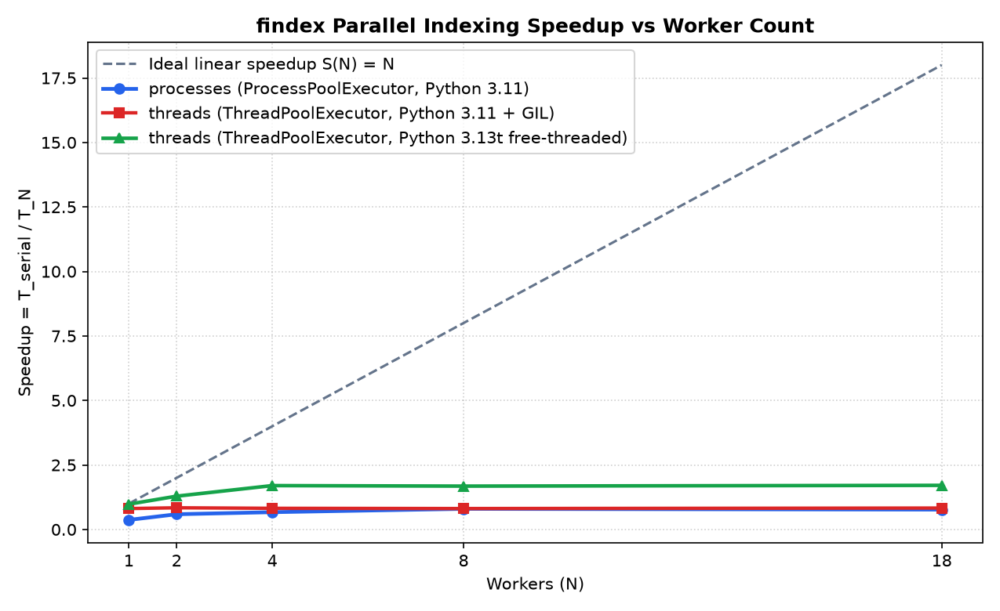

# Конкурентність, GIL та паралельна індексація у `findex`

## 1. Апаратне та програмне середовище

- **Процесор:** `Apple M5 Pro`
- **Логічні ядра (`os.cpu_count()`):** `18`
- **Стандартний інтерпретатор (з GIL):** Python `3.11.18` (`sys._is_gil_enabled() == True`)
- **Free-threaded інтерпретатор (без GIL):** Python `3.13.18` (`sys._is_gil_enabled() == False`)
- **Метод запуску процесів на macOS:** `spawn` (кожен воркер стартує новий інтерпретатор без `fork` та обмінюється даними через `pickle`).

---

## 2. Зведені результати замірів (медіана з 3 прогонів на корпусі `data/`)

### Python `3.11.18` (`sys._is_gil_enabled() == True`)

| Executor | Workers | Wall time (s) | CPU time (s) | Merge time (ms) | Parent Peak RSS (MiB) | Speedup |
| :--- | ---: | ---: | ---: | ---: | ---: | ---: |
| `serial` | 1 | 0.6195 | 0.6192 | 0.84 | 136.0 | **1.00x** |
| `threads` | 1 | 0.7661 | 0.7662 | 103.68 | 148.2 | **0.81x** |
| `threads` | 2 | 0.7364 | 0.7391 | 96.32 | 160.1 | **0.84x** |
| `threads` | 4 | 0.7548 | 0.7604 | 98.45 | 171.8 | **0.82x** |
| `threads` | 8 | 0.7651 | 0.7758 | 96.62 | 174.9 | **0.81x** |
| `threads` | 18 | 0.7480 | 0.7658 | 86.09 | 187.7 | **0.83x** |
| `processes` | 1 | 1.6774 | 0.4634 | 71.24 | 268.9 | **0.37x** |
| `processes` | 2 | 1.0502 | 0.5352 | 81.19 | 306.5 | **0.59x** |
| `processes` | 4 | 0.9185 | 0.6007 | 110.45 | 307.1 | **0.67x** |
| `processes` | 8 | 0.7708 | 0.6145 | 102.83 | 311.6 | **0.80x** |
| `processes` | 18 | 0.8013 | 0.6866 | 112.42 | 313.6 | **0.77x** |

### Python `3.13.18` free-threaded (`sys._is_gil_enabled() == False`)

| Executor | Workers | Wall time (s) | CPU time (s) | Merge time (ms) | Parent Peak RSS (MiB) | Speedup |
| :--- | ---: | ---: | ---: | ---: | ---: | ---: |
| `serial` | 1 | 0.7088 | 0.7084 | 1.11 | 161.6 | **1.00x** |
| `threads` | 1 | 0.7264 | 0.7264 | 54.88 | 293.6 | **0.98x** |
| `threads` | 2 | 0.5476 | 0.7671 | 59.90 | 339.4 | **1.29x** |
| `threads` | 4 | 0.4161 | 0.8536 | 60.65 | 378.0 | **1.70x** |
| `threads` | 8 | 0.4207 | 1.2671 | 60.58 | 472.8 | **1.68x** |
| `threads` | 18 | 0.4155 | 1.8414 | 64.39 | 593.0 | **1.71x** |

---

## 3. Аналіз результатів: GIL, процеси, `pickle` та закон Амдала

### Чому потоки під GIL (`Python 3.11.18`) не прискорили індексацію?
Індексація у `build_partial` є **CPU-bound** задачею: регулярний вираз токенізатора (`re.finditer`), побудова словників позицій `defaultdict(list)` та створення об'єктів `Posting` повністю виконуються в байткоді CPython. Під стандартним GIL одночасно лише один потік володіє інтерпретатором і виконує Python-байткод. Коли ми запускаємо 2, 4, 8 або 18 потоків, усі вони по черзі чекають на звільнення GIL кожні `sys.getswitchinterval()` (5 мс), додаючи накладні витрати на перемикання контексту без реального паралелізму на ядрах процесора (найкращий результат потоків під GIL — `0.84x`).

### Що дали процеси (`ProcessPoolExecutor`) і чим це оплачено?
Кожен процес у `ProcessPoolExecutor` має власний екземпляр інтерпретатора CPython і власний незалежний GIL, тому токенізація та побудова часткових індексів (`build_partial`) реально виконуються паралельно на різних ядрах процесора: час `wall_time` зменшився з `1.6774s` (1 процес) до `0.7708s` (8 процесів — прискорення у `2.18x` відносно 1 воркера).

Проте паралелізм через процеси має три вимірювані ціни:
1. **Вартість `spawn` + `pickle` IPC:** на невеликому корпусі (~0.62s у `serial`) запуск воркерів через `spawn` на macOS і зворотна серіалізація великих словників `PartialIndex` (`dict[str, list[Posting]]`) через `pickle` в батьківський процес займають ~0.6–0.7 с. Саме тому на малому корпусі `processes` мають `speedup = 0.80x` відносно однопотокового `serial` без IPC — накладні витрати на серіалізацію перевищують виграш від розподілу CPU-роботи (поріг окупності `ProcessPoolExecutor` настає на більших корпусах від десятків тисяч документів).
2. **`CPU time` проти `Wall time`:** у `ProcessPoolExecutor` `cpu_time` батьківського процесу відображає роботу координатора (серіалізацію/десеріалізацію `pickle` та `merge_partials`), тоді як сумарний процесорний час усіх дочірніх воркерів зростає пропорційно кількості воркерів через дублювання інтерпретаторів і витрати на `pickle`.
3. **Пам'ять (RSS):** кожен дочірній процес виділяє власну купу під Python runtime і свій локальний `PartialIndex`, а батьківський процес під час `merge_partials` одночасно тримає в пам'яті десеріалізовані шарди та фінальний індекс (пік RSS батьківського процесу зріс до `311.6 MiB`).

### Де у часі `merge_partials` проявляється закон Амдала?
За законом Амдала максимальне прискорення обмежене послідовною часткою програми $s$:
$$S(N) = \frac{1}{s + \frac{1 - s}{N}}$$
У нашій архітектурі `build_partial` — повністю паралельна частина ($1 - s$), а **`merge_partials`** — строго послідовна фаза ($s$), що виконується в одному потоці координатора після завершення всіх воркерів. Як видно з таблиці, час `merge_partials` становить близько `102.8 ms` і не зменшується зі збільшенням `N` (навіть трохи зростає через більшу кількість шардів). Навіть за нескінченної кількості ядер ($N \to \infty$) загальний час збірки не може бути меншим за `T_merge + T_ipc`.

### Що змінилось у Python `3.13.18` без GIL (`sys._is_gil_enabled() == False`)?
Збірка `3.13t` прибирає глобальне блокування інтерпретатора, дозволяючи потокам `ThreadPoolExecutor` одночасно виконувати Python-байткод на різних ядрах **у спільному адресному просторі** — без запуску нових процесів (`spawn`) і без серіалізації `PartialIndex` через `pickle`! Завдяки відсутності витрат на IPC потоки у `3.13t` досягли прискорення **`1.71x`** на `18` воркерах, обігнавши як потоки з GIL (`0.84x`), так і багатопроцесорний варіант (`0.80x`).

### Яких інваріантів не захищає GIL і чому потрібен `threading.Lock`?
Навіть у стандартному Python з GIL перемикання потоків може відбутися між будь-якими двома інструкціями байткоду. У збірці `3.13t` без GIL це стає критичним:
- **Неатомарна операція читання-модифікації-запису (`count = counts[k]; counts[k] = count + 1`):** два потоки одночасно читають старе значення лічильника і перезаписують одне одного, гублячи частину інкрементів (у нашому тесті без `Lock` зі 160 000 інкрементів у 8 потоках частина оновлень губиться, тоді як із `threading.Lock` результат завжди точний — `160000`).
- **Архітектурний захист у `findex`:** замість того щоб ставити глобальний `Lock` навколо спільного `Index` (що знову перетворило б паралельну індексацію на послідовну через блокування), ми застосували шаблон **Map-Reduce (share-nothing)**: кожен воркер працює виключно зі своїм ізольованим `PartialIndex` і заздалегідь виділеним неперетинним діапазоном `doc_id`, а об'єднання відбувається однопотоково у `merge_partials`.
